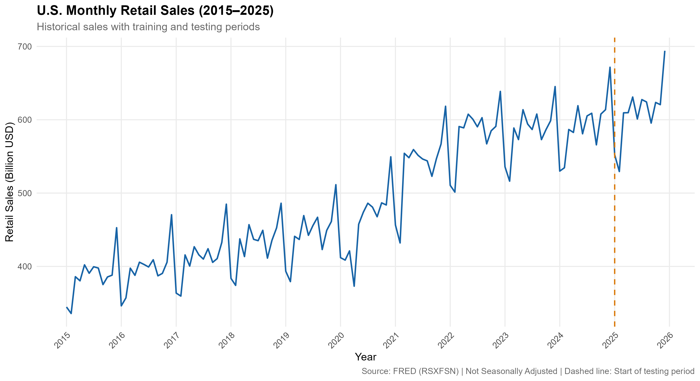
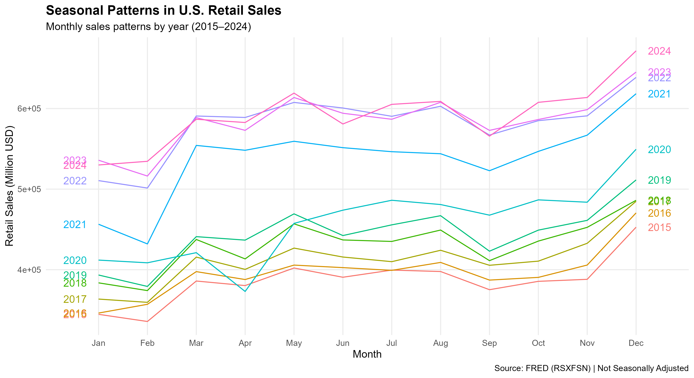
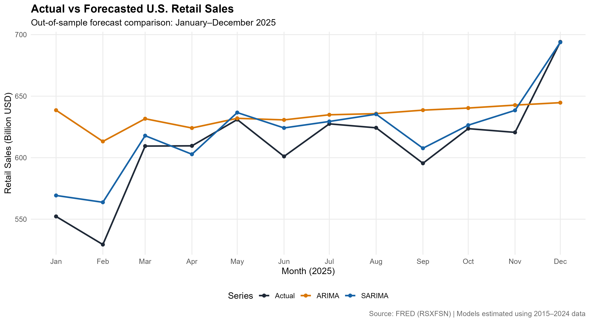
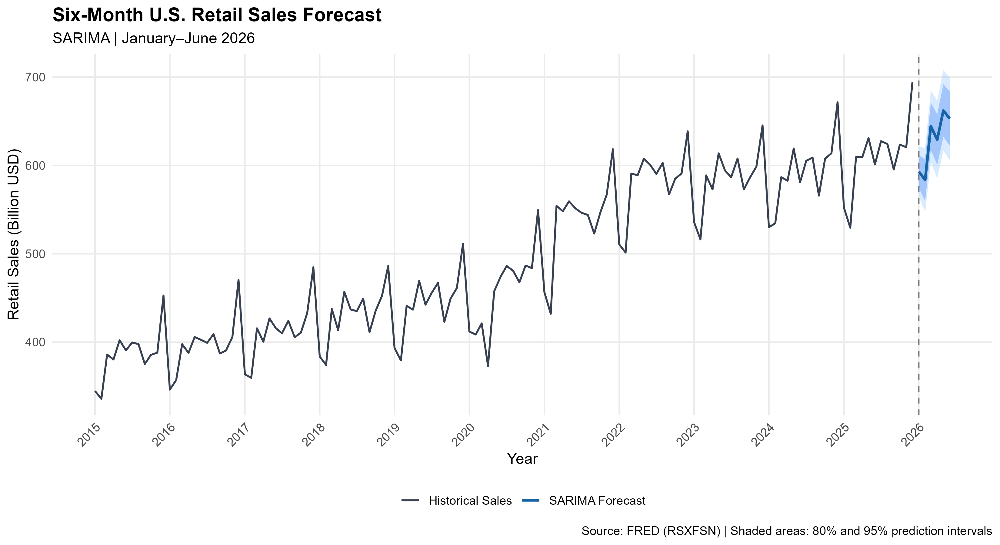

# U.S. Retail Sales Forecasting Using ARIMA and SARIMA in R

# Project Overview

This project develops and evaluates time-series forecasting models for monthly U.S. retail trade sales using R and data from the Federal Reserve Economic Data (FRED) database.

The objective is to compare nonseasonal ARIMA and seasonal ARIMA (SARIMA) models, identify the more accurate approach, and demonstrate how short-term forecasts can support business planning.

# Business Problem

Retail businesses need reliable demand forecasts to support inventory management, staffing, budgeting, and operational planning.

Monthly retail sales exhibit long-term trends and seasonal fluctuations, making accurate forecasting challenging.

Research Question: Does incorporating seasonality improve short-term retail sales forecasting accuracy?

## Data

- Source: Federal Reserve Economic Data (FRED)
- Series:RSXFSN — Advance Retail Sales: Retail Trade
- Frequency: Monthly, not seasonally adjusted
- Unit: Millions of U.S. dollars
- Analysis period: January 2015 – December 2025
- Training period: January 2015 – December 2024
- Testing period: January 2025 – December 2025
- Forecast horizon: January–June 2026

Data source: https://fred.stlouisfed.org/series/RSXFSN

# Methodology

The analysis was conducted using R and RStudio.

1. Imported and prepared monthly retail sales data.
2. Examined historical trends and recurring seasonal patterns.
3. Investigated stationarity and differencing requirements.
4. Estimated nonseasonal ARIMA and seasonal SARIMA models.
5. Evaluated model performance using a 12-month out-of-sample test period.
6. Examined residual diagnostics.
7. Produced six-month forecasts with 80% and 95% prediction intervals.

# Model Performance

| Metric | ARIMA | SARIMA |
|---|---:|---:|
| MAE (Million USD) | 32,328.38 | **11,816.40** |
| RMSE (Million USD) | 42,161.33 | **15,171.80** |
| MAPE | 5.52% | **2.03%** |

SARIMA achieved approximately a **64% reduction in RMSE** compared with the nonseasonal ARIMA benchmark.

The selected seasonal model was ARIMA(1,0,0)(2,1,2)[12] with drift.

# Visualizations

# 1. Historical Retail Sales

# 2. Seasonal Patterns

# 3. Actual vs. Forecasted Sales

# 4. Six-Month SARIMA Forecast

| Month | Forecast (Billion USD) |
|---|---:|
| January 2026 | 593.12 |
| February 2026 | 584.45 |
| March 2026 | 644.34 |
| April 2026 | 629.22 |
| May 2026 | 662.14 |
| June 2026 | 653.02 |

These forecasts were produced using data through December 2025 and represent a historical forecasting exercise.

# Business Applications

The forecasting framework can support:

- Inventory planning: Anticipating seasonal changes in market demand.
- Workforce planning: Aligning staffing decisions with expected demand patterns.
- Financial planning: Supporting budgeting and sales scenario development.
- Risk assessment: Evaluating forecast uncertainty using prediction intervals.

National retail sales should be treated as a market indicator rather than a direct forecast of an individual company's revenue.

# Limitations

- The analysis uses nominal national retail trade sales rather than company-level transactions.
- Unusual economic disruptions, particularly COVID-19, affect model performance.
- Forecast accuracy was evaluated on one 12-month holdout period.
- The forecasting exercise uses historical information through December 2025.

# Tools and Technologies

- R and RStudio
- forecast
- ggplot2
- readxl
- dplyr
- lubridate
- tidyr

# Reproducing the Analysis

1. Install R and RStudio.
2. Download or clone this repository.
3. Open `retail-sales-forecasting-r.Rproj`.
4. Install the required R packages.
5. Run `script/retail_forecasting.R`.

The script reads the dataset from the `data` directory and generates the forecasting outputs.

# Additional Analysis

For a detailed business interpretation, see [Business Insights](Business_insights.md).